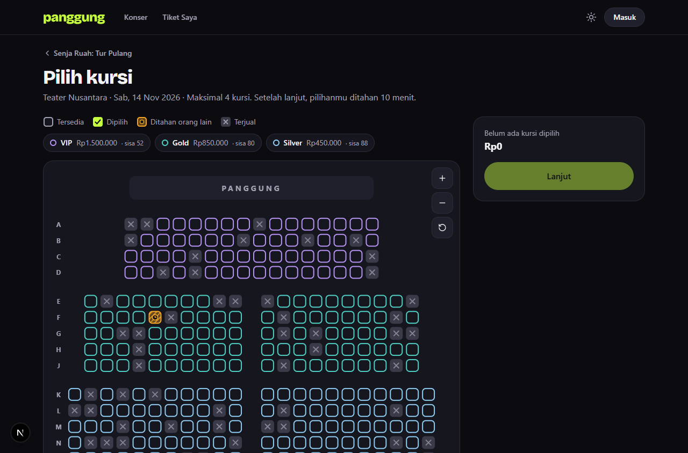
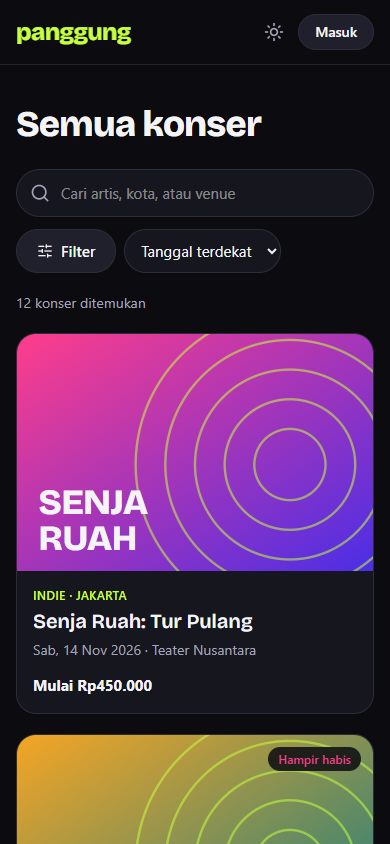
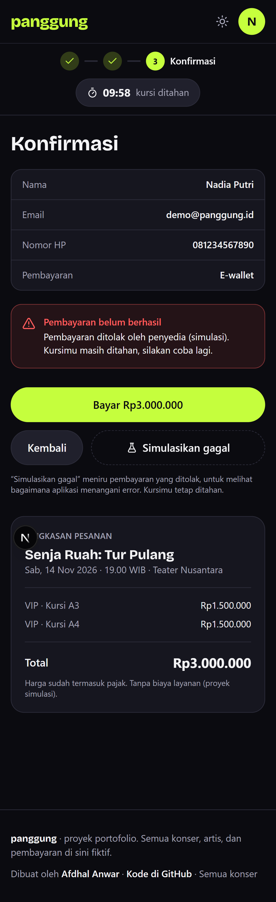
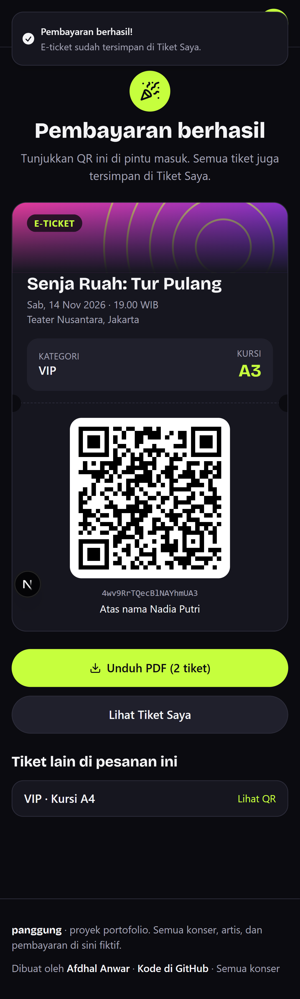
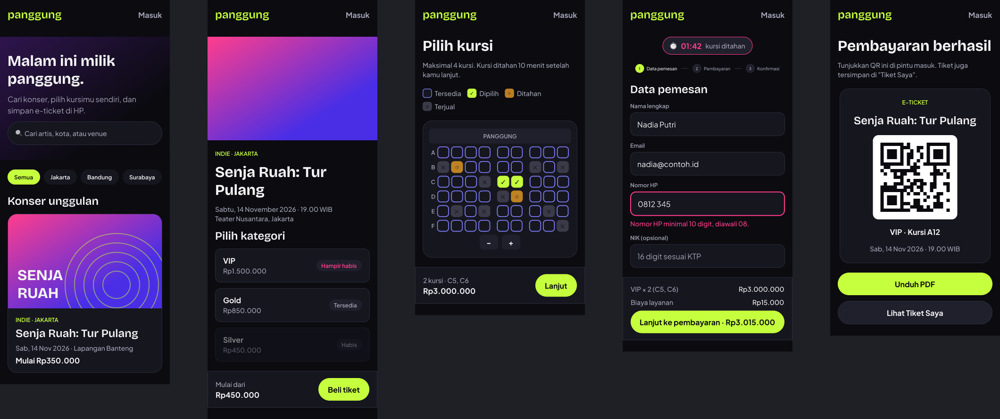

# Panggung — web tiket konser

[](https://github.com/afdhalwr/panggung/actions/workflows/ci.yml)

Web pemesanan tiket konser dengan **seat map interaktif**, **hold kursi 10 menit** yang benar-benar mencegah double booking, checkout 3 langkah, dan **e-ticket ber-QR** yang bisa diunduh PDF. Semua konser dan pembayaran fiktif, jadi aman dicoba.

<p align="center">
  
</p>

| Daftar konser (HP) | Gagal bayar, kursi tetap ditahan | E-ticket |
| --- | --- | --- |
|  |  |  |

## Coba dalam 2 menit

1. Buka halaman **Masuk**, tekan **Masuk sebagai demo** (`demo@panggung.id` / `demo1234`). Akun ini sudah punya riwayat tiket.
2. Pilih konser **Senja Ruah: Tur Pulang** atau **Rinai di Teater**, lalu **Pilih kursi**. Bisa pakai mouse, sentuh, atau keyboard (Tab, panah, Enter).
3. Tekan **Lanjut**. Kursi ditahan 10 menit, dan countdown terlihat di setiap langkah.
4. Isi data pemesan, pilih metode bayar. Di langkah konfirmasi, coba **Simulasikan gagal** dulu, lalu **Bayar**.
5. E-ticket muncul dengan QR. Tekan **Unduh PDF**.

Untuk melihat rebutan kursi: buka denah yang sama di dua browser dengan dua akun berbeda. Kursi yang ditahan satu akun langsung berubah status di browser lain.

## Yang membuatnya lebih dari CRUD biasa

| Masalah | Cara Panggung menanganinya |
| --- | --- |
| Dua orang memilih kursi yang sama | `POST /api/orders` menjalankan **Firestore transaction**. Yang kalah mendapat `409` berisi daftar kursinya; UI melepas kursi itu dan menampilkan toast. |
| Kursi pilihan diambil orang lain saat masih memilih | Status kursi didengarkan real-time (`onSnapshot`). Kursi yang hilang dilepas otomatis dari pilihan. |
| Hold kedaluwarsa tanpa server latar | Tidak ada cron. Server dan klien sama-sama memakai `isSeatAvailable()` di [`src/lib/rules.ts`](src/lib/rules.ts): hold yang lewat `holdExpiresAt` dianggap kosong. |
| Jam HP pengguna tidak akurat | Countdown memakai selisih `serverNow − Date.now()` yang dicatat saat hold dibuat. |
| Harga diubah lewat DevTools | Klien hanya mengirim kategori dan kursi. Total dihitung server dari data seed. |
| Browser menulis langsung ke database | [`firestore.rules`](firestore.rules) menolak **semua** penulisan dari browser. Penulisan hanya lewat Route Handler + Firebase Admin SDK setelah ID token diverifikasi. |
| QR tiket dipalsukan | Isi QR `PANGGUNG.<id>.<HMAC>`, ditandatangani dengan kunci rahasia server ([`src/server/qr.ts`](src/server/qr.ts)). |
| Pembayaran gagal | `?fail=true` meniru penolakan: order tetap `pending`, kursi tetap ditahan, pengguna bisa mencoba lagi. |

## Keputusan teknis

- **Satu skema Zod untuk klien dan server.** [`src/lib/schemas.ts`](src/lib/schemas.ts) dipakai React Hook Form di checkout dan Route Handler di server, jadi pesan error-nya sama persis.
- **Lapisan repository.** UI hanya memanggil [`ordersRepository`](src/features/orders/repository.ts); ia tidak tahu ada Firestore di baliknya.
- **Aturan bisnis sebagai fungsi murni.** Ketersediaan kursi, kuota festival, total harga, dan status order ada di `lib/rules.ts` dan diuji tanpa Firestore.
- **Zustand + persist** untuk pilihan kursi dan isian checkout, sehingga reload tidak menghapus apa pun. Kembali ke langkah sebelumnya juga tidak menghapus isian.
- **Bundle tetap ringan.** Firebase Auth dimuat lazy saat browser senggang, Firestore hanya di halaman denah, `@react-pdf/renderer` baru dimuat saat tombol unduh ditekan. First Load JS beranda dan detail konser: **113 kB**.
- **Poster SVG generatif.** Konser fiktif tidak punya foto artis, jadi poster dibuat dari palet dan pola di data seed. Foto suasana di hero berasal dari Unsplash.

## Kualitas

| Cek | Hasil |
| --- | --- |
| Unit & komponen (Vitest + Testing Library) | 47 test: aturan hold, skema, katalog, QR, cart store, navigasi keyboard seat map |
| E2E (Playwright + Firebase Emulator) | 3 skenario: alur demo lengkap, bayar gagal lalu sukses, timer habis |
| TypeScript | `strict`, tanpa `any` di `src/` |
| Lighthouse mobile (lokal, build produksi) | Performa 85–95 per run, Aksesibilitas 100, Best Practices 100, SEO 100 di halaman detail konser |
| Responsif | 360–1440 px tanpa scroll horizontal |

## Proses desain

Desain dibuat dulu di Figma sebagai design system kecil: variables warna mode gelap dan terang, gaya teks (Bricolage Grotesque + Plus Jakarta Sans), komponen (EventCard, Seat 4 status, CountdownBadge, Stepper, TicketCard), dan lima layar HP. Token warna di [`globals.css`](src/app/globals.css) sama dengan variables Figma.

<p align="center">
  
</p>

Spesifikasi teknis dan rencana implementasi ada di [`docs/superpowers/specs`](docs/superpowers/specs) dan [`docs/superpowers/plans`](docs/superpowers/plans).

## Stack

Next.js 15 (App Router) · TypeScript · Tailwind CSS v4 · komponen gaya shadcn/ui di atas Radix · Zustand · TanStack Query · React Hook Form + Zod · Firebase Auth & Firestore · Firebase Admin SDK · react-zoom-pan-pinch · qrcode.react · @react-pdf/renderer · Vitest · Playwright · GitHub Actions · Vercel

```
src/
  app/                 halaman (App Router) dan Route Handler di app/api
  components/          seat-map/, checkout/, event/, ticket/, ui/
  features/            auth/, cart/ (Zustand), orders/ (repository), seats/ (onSnapshot)
  lib/                 schemas (Zod), rules (aturan bisnis), catalog (data seed), firebase/
  server/              orders (transaction), auth (verifikasi token), qr (HMAC)
  data/seed/           12 konser fiktif, denah Teater Nusantara (274 kursi)
e2e/                   skenario Playwright
```

## Menjalankan di komputer sendiri

Butuh Node.js 24 dan Java 21+ (untuk Firebase Emulator).

```bash
npm install
cp .env.example .env.local    # biarkan NEXT_PUBLIC_USE_EMULATOR=1
npm run emulators             # terminal 1: Auth + Firestore emulator (UI di localhost:4000)
npm run seed:demo             # terminal 2: buat akun demo + riwayat tiket
npm run dev                   # buka http://localhost:3000
```

Perintah lain: `npm test` (unit), `npm run e2e` (Playwright, butuh emulator dan dev server), `npm run lint`, `npm run typecheck`.

## Deploy ke Firebase asli + Vercel

1. Buat project baru di [Firebase Console](https://console.firebase.google.com). Aktifkan **Authentication → Email/Password** dan **Firestore Database**.
2. Tambahkan Web App, salin nilai config ke `NEXT_PUBLIC_FIREBASE_*`.
3. **Project settings → Service accounts → Generate new private key**. Isi `FIREBASE_ADMIN_PROJECT_ID`, `FIREBASE_ADMIN_CLIENT_EMAIL`, dan `FIREBASE_ADMIN_PRIVATE_KEY`.
4. Terbitkan rules: `npx firebase deploy --only firestore:rules --project <project-id>`.
5. Isi semua env di Vercel dengan `vercel env add NAMA production --value "..."`. Jangan pakai pipe dari PowerShell, karena itu menambahkan BOM. Set `NEXT_PUBLIC_USE_EMULATOR=0`.
6. Isi `.env.local` dengan kredensial yang sama, lalu jalankan `npm run seed:demo` sekali untuk membuat akun demo di project asli.

## Kredit

- Foto suasana konser dari [Unsplash](https://unsplash.com) (daftar di [`public/photos/CREDITS.md`](public/photos/CREDITS.md)).
- Semua nama artis, venue, dan konser fiktif.

Dibuat oleh **Afdhal Anwar** · [LinkedIn](https://www.linkedin.com/in/afdhal-anwar-431779211) · [GitHub](https://github.com/afdhalwr)
