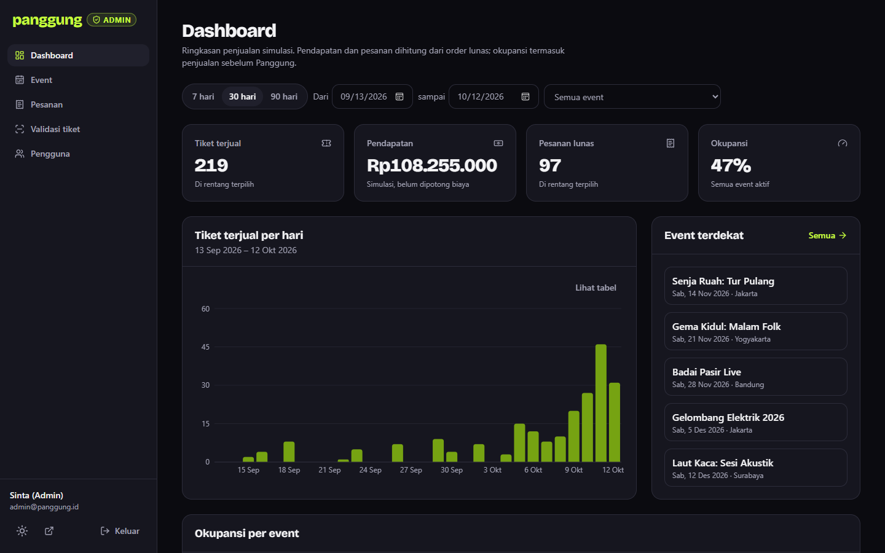
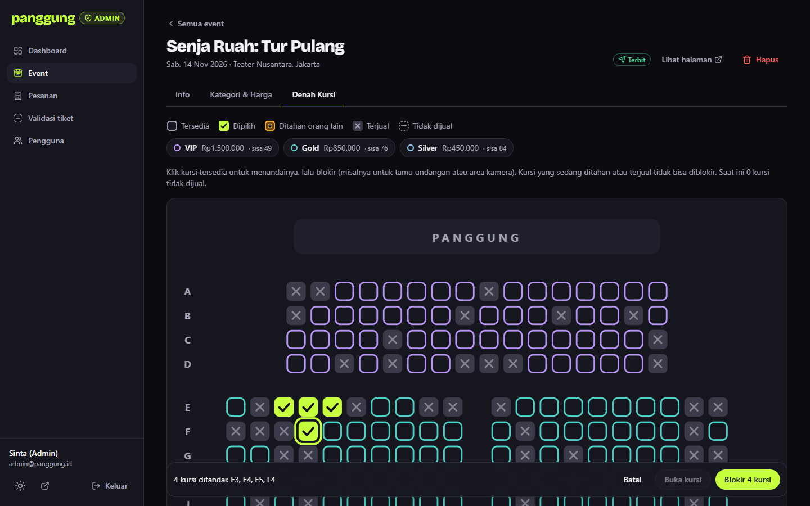
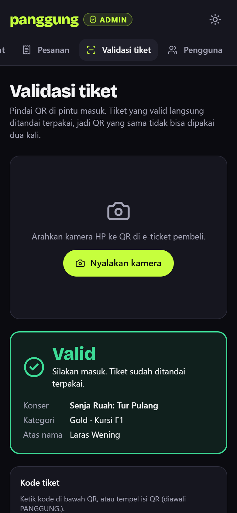

# Panggung — web tiket konser

[](https://github.com/afdhalwr/panggung/actions/workflows/ci.yml)

Web pemesanan tiket konser dengan **seat map interaktif**, **hold kursi 10 menit** yang benar-benar mencegah double booking, checkout 3 langkah, dan **e-ticket ber-QR** yang bisa diunduh PDF. Penyelenggara punya **dashboard admin** terpisah: statistik penjualan, kelola event dan harga, blokir kursi, refund, validasi tiket di pintu masuk, dan kelola akun. Semua konser dan pembayaran fiktif, jadi aman dicoba.

<p align="center">
  
</p>

| Daftar konser (HP) | Gagal bayar, kursi tetap ditahan | E-ticket |
| --- | --- | --- |
|  |  |  |

<p align="center">
  
</p>

| Blokir kursi di denah (admin) | Validasi tiket di HP |
| --- | --- |
|  |  |

## Coba dalam 2 menit

1. Buka halaman **Masuk**, tekan **Masuk sebagai Pengguna** (`demo@panggung.id` / `demo1234`). Akun ini sudah punya riwayat tiket.
2. Pilih konser **Senja Ruah: Tur Pulang** atau **Rinai di Teater**, lalu **Pilih kursi**. Bisa pakai mouse, sentuh, atau keyboard (Tab, panah, Enter).
3. Tekan **Lanjut**. Kursi ditahan 10 menit, dan countdown terlihat di setiap langkah.
4. Isi data pemesan, pilih metode bayar. Di langkah konfirmasi, coba **Simulasikan gagal** dulu, lalu **Bayar**.
5. E-ticket muncul dengan QR. Tekan **Unduh PDF**.

Untuk melihat rebutan kursi: buka denah yang sama di dua browser dengan dua akun berbeda. Kursi yang ditahan satu akun langsung berubah status di browser lain.

**Sisi admin.** Keluar, lalu tekan **Masuk sebagai Admin** (`admin@panggung.id` / `admin1234`):

1. **Dashboard** menampilkan tiket terjual, pendapatan, okupansi, dan grafik harian. Coba ganti rentang tanggal atau pilih satu event.
2. **Event → Senja Ruah → Kategori & Harga**: ubah harga, simpan, lalu buka halaman konsernya. Harga baru langsung tampil.
3. **Denah Kursi**: tandai beberapa kursi, lalu **Blokir**. Di denah pembeli kursi itu langsung menjadi "tidak dijual".
4. **Pesanan**: cari nama pembeli, buka detail, lalu **Refund**. Kursinya dilepas dan QR tiketnya ditolak.
5. **Validasi tiket**: ketik kode di bawah QR e-ticket (atau pindai dengan kamera HP). Pindaian pertama **Valid**, berikutnya **Sudah dipakai**.
6. **Pengguna**: nonaktifkan akun pembeli fiktif. Sesinya langsung dicabut dan akun itu tidak bisa masuk lagi.

Akun pengguna yang membuka `/admin` melihat halaman 403, dan semua `/api/admin/*` membalas 401/403.

## Yang membuatnya lebih dari CRUD biasa

| Masalah | Cara Panggung menanganinya |
| --- | --- |
| Dua orang memilih kursi yang sama | `POST /api/orders` menjalankan **Firestore transaction**. Yang kalah mendapat `409` berisi daftar kursinya; UI melepas kursi itu dan menampilkan toast. |
| Kursi pilihan diambil orang lain saat masih memilih | Status kursi didengarkan real-time (`onSnapshot`). Kursi yang hilang dilepas otomatis dari pilihan. |
| Hold kedaluwarsa tanpa server latar | Tidak ada cron. Server dan klien sama-sama memakai `isSeatAvailable()` di [`src/lib/rules.ts`](src/lib/rules.ts): hold yang lewat `holdExpiresAt` dianggap kosong. |
| Jam HP pengguna tidak akurat | Countdown memakai selisih `serverNow − Date.now()` yang dicatat saat hold dibuat. |
| Harga diubah lewat DevTools | Klien hanya mengirim kategori dan kursi. Total dihitung server dari data seed. |
| Browser menulis langsung ke database | [`firestore.rules`](firestore.rules) menolak **semua** penulisan dari browser. Penulisan hanya lewat Route Handler + Firebase Admin SDK setelah ID token diverifikasi. |
| QR tiket dipalsukan | Isi QR `PANGGUNG.<id>.<HMAC>`, ditandatangani dengan kunci rahasia server ([`src/server/qr.ts`](src/server/qr.ts)). |
| Pembayaran gagal | `?fail=true` meniru penolakan: order tetap `pending`, kursi tetap ditahan, pengguna bisa mencoba lagi. |
| War tiket | Konser "panas" (Gelombang Elektrik 2026) memakai ruang tunggu simulasi: posisi dan perkiraan waktu turun bertahap, menutup halaman memunculkan peringatan, lolos antrean berlaku 15 menit. |
| API admin dipanggil pengguna biasa | Setiap Route Handler `/api/admin/*` memanggil [`requireRole('admin')`](src/server/auth.ts): ID token diverifikasi (termasuk apakah sudah dicabut) dan perannya dibaca dari custom claim Firebase. Menyembunyikan tombol hanya untuk UX. |
| Halaman admin sempat tampil sebelum ditolak | Layout `/admin` memverifikasi Firebase **session cookie httpOnly** di server sebelum merender apa pun. Middleware membaca cookie petunjuk peran untuk mengalihkan tanpa kedipan. |
| Admin mengubah kuota di bawah tiket terjual | Kuota festival divalidasi di dalam transaction terhadap terjual + hold aktif; kategori yang sudah terjual tidak bisa dihapus. |
| Kursi diblokir saat sedang ditahan pembeli | Blokir hanya untuk kursi yang benar-benar kosong (`canBlockSeat`). Kursi diblokir tersimpan sebagai status `blocked`, jadi denah pembeli ikut berubah lewat `onSnapshot`. |
| Refund setengah jadi | Order, tiket, kursi, dan kuota festival diperbarui dalam satu transaction. |
| Satu QR dipakai dua orang | Validasi menandai `usedAt` dalam transaction; pindaian kedua selalu "Sudah dipakai". |
| Pengunjung demo merusak akun demo | Akun demo tidak bisa dinonaktifkan, sandinya tidak bisa diubah dari halaman profil, dan `npm run seed:demo` memulihkannya. Event yang sudah punya pesanan tidak bisa dihapus. |

## Keputusan teknis

- **Satu skema Zod untuk klien dan server.** [`src/lib/schemas.ts`](src/lib/schemas.ts) dan [`src/lib/admin-schemas.ts`](src/lib/admin-schemas.ts) dipakai React Hook Form dan Route Handler, jadi pesan error-nya sama persis.
- **Event di Firestore, halaman publik tetap cepat.** Event dibaca lewat `unstable_cache` bertag `events`; setiap perubahan admin memanggil `revalidateTag`. Build tidak butuh akses database, dan TTFB halaman publik dari cache sekitar 20 ms di build produksi lokal. Data seed ditulis sekali saat project masih kosong.
- **Peran tanpa Auth.js.** Login tetap Firebase Auth; peran admin disimpan sebagai custom claim, sehingga terbawa di ID token dan session cookie tanpa query tambahan.
- **Halaman admin sebagai Server Component.** Data dibaca langsung di server setelah verifikasi sesi, jadi tabel dan dashboard tampil tanpa loading. Mutasi lewat Route Handler dengan `requireRole`.
- **Lapisan repository.** UI hanya memanggil [`ordersRepository`](src/features/orders/repository.ts); ia tidak tahu ada Firestore di baliknya.
- **Aturan bisnis sebagai fungsi murni.** Ketersediaan kursi, kuota festival, total harga, dan status order ada di `lib/rules.ts` dan diuji tanpa Firestore.
- **Zustand + persist** untuk pilihan kursi dan isian checkout, sehingga reload tidak menghapus apa pun. Kembali ke langkah sebelumnya juga tidak menghapus isian.
- **Bundle tetap ringan.** Firebase Auth dimuat lazy saat browser senggang, Firestore hanya di halaman denah, `@react-pdf/renderer` baru dimuat saat tombol unduh ditekan. First Load JS beranda dan detail konser: **113 kB**.
- **Poster SVG generatif.** Konser fiktif tidak punya foto artis, jadi poster dibuat dari palet dan pola di data seed. Foto suasana di hero berasal dari Unsplash.

## Kualitas

| Cek | Hasil |
| --- | --- |
| Unit & komponen (Vitest + Testing Library) | 67 test: aturan hold dan kursi diblokir, kuota minimum, refund, statistik dashboard, skema, katalog, QR dan kode tiket, cart store, navigasi keyboard seat map, ruang tunggu antrean |
| E2E (Playwright + Firebase Emulator) | 6 skenario: alur demo lengkap, bayar gagal lalu sukses, timer habis, pengguna ditolak di dashboard dan API admin (403), admin memblokir kursi yang langsung tampil di denah pembeli, validasi tiket Valid lalu Sudah dipakai |
| TypeScript | `strict`, tanpa `any` di `src/` |
| Lighthouse mobile (lokal, build produksi) | Performa 85–95 per run, Aksesibilitas 100, Best Practices 100, SEO 100 di halaman detail konser |
| Responsif | 360–1440 px tanpa scroll horizontal |

## Proses desain

Desain dibuat dulu di Figma sebagai design system kecil: variables warna mode gelap dan terang, gaya teks (Bricolage Grotesque + Plus Jakarta Sans), komponen (EventCard, Seat 4 status, CountdownBadge, Stepper, TicketCard), dan lima layar HP. Token warna di [`globals.css`](src/app/globals.css) sama dengan variables Figma.

<p align="center">
  
</p>

Spesifikasi teknis dan rencana implementasi ada di [`docs/superpowers/specs`](docs/superpowers/specs) dan [`docs/superpowers/plans`](docs/superpowers/plans).

## Stack

Next.js 15 (App Router) · TypeScript · Tailwind CSS v4 · komponen gaya shadcn/ui di atas Radix · Zustand · TanStack Query · TanStack Table · Recharts · React Hook Form + Zod · Firebase Auth & Firestore · Firebase Admin SDK · react-zoom-pan-pinch · qrcode.react · @react-pdf/renderer · html5-qrcode · Vitest · Playwright · GitHub Actions · Vercel

```
src/
  middleware.ts        pengalihan sesuai peran (/admin, /checkout, /tickets, /login)
  app/(site)/          halaman pembeli dengan header dan footer publik
  app/admin/           dashboard admin (layout sidebar, diverifikasi di server)
  app/api/             Route Handler; app/api/admin/* hanya untuk admin
  components/          seat-map/, checkout/, event/, ticket/, admin/, ui/
  features/            auth/, cart/ (Zustand), orders/ dan admin/ (repository), seats/ (onSnapshot)
  lib/                 schemas + admin-schemas (Zod), rules (aturan bisnis), stats, catalog, firebase/
  server/              orders (transaction), catalog (cache event), session, auth (requireRole), admin/*, qr
  data/seed/           12 konser fiktif, denah Teater Nusantara (274 kursi)
e2e/                   skenario Playwright
```

## Menjalankan di komputer sendiri

Butuh Node.js 24 dan Java 21+ (untuk Firebase Emulator).

```bash
npm install
cp .env.example .env.local    # biarkan NEXT_PUBLIC_USE_EMULATOR=1
npm run emulators             # terminal 1: Auth + Firestore emulator (UI di localhost:4000)
npm run seed:demo             # terminal 2: akun demo pengguna + admin, riwayat tiket, ±120 pesanan simulasi
npm run dev                   # buka http://localhost:3000
```

Perintah lain: `npm test` (unit), `npm run e2e` (Playwright, butuh emulator dan dev server), `npm run lint`, `npm run typecheck`.

## Deploy ke Firebase asli + Vercel

1. Buat project baru di [Firebase Console](https://console.firebase.google.com). Aktifkan **Authentication → Email/Password** dan **Firestore Database**.
2. Tambahkan Web App, salin nilai config ke `NEXT_PUBLIC_FIREBASE_*`.
3. **Project settings → Service accounts → Generate new private key**. Isi `FIREBASE_ADMIN_PROJECT_ID`, `FIREBASE_ADMIN_CLIENT_EMAIL`, dan `FIREBASE_ADMIN_PRIVATE_KEY`.
4. Terbitkan rules: `npx firebase deploy --only firestore:rules --project <project-id>`.
5. Isi semua env di Vercel dengan `vercel env add NAMA production --value "..."`. Jangan pakai pipe dari PowerShell, karena itu menambahkan BOM. Set `NEXT_PUBLIC_USE_EMULATOR=0`.
6. Isi `.env.local` dengan kredensial yang sama, lalu jalankan `npm run seed:demo` sekali untuk membuat akun demo (termasuk admin dengan custom claim) dan data dashboard di project asli. Menjalankannya lagi memulihkan sandi dan status akun demo bila sempat diubah pengunjung.

## Kredit

- Foto suasana konser dari [Unsplash](https://unsplash.com) (daftar di [`public/photos/CREDITS.md`](public/photos/CREDITS.md)).
- Semua nama artis, venue, dan konser fiktif.

Dibuat oleh **Afdhal Anwar** · [LinkedIn](https://www.linkedin.com/in/afdhal-anwar-431779211) · [GitHub](https://github.com/afdhalwr)
